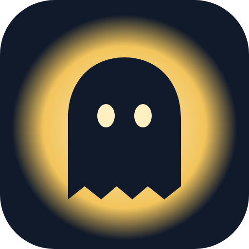

#  Phasmo Helper

**TR** · Phasmophobia oynarken oyunun üstünde duran, resmi olmayan küçük bir yardımcı pencere.
**EN** · An unofficial, always-on-top companion overlay for Phasmophobia.

## İndir / Download

[**Releases**](https://github.com/wiesdante/phasmo-helper/releases/latest) sayfasından `Phasmo-Helper-Setup-x.y.z.exe` dosyasını indirip çalıştır.
Download `Phasmo-Helper-Setup-x.y.z.exe` from the [**Releases**](https://github.com/wiesdante/phasmo-helper/releases/latest) page and run it.

- Uygulama kendini **otomatik günceller**. / The app **updates itself automatically**.
- Kurulum dosyası imzalı değildir; Windows "bilgisayarınızı korudu" derse **Ek bilgi → Yine de çalıştır**.
  The installer is not code-signed; if Windows SmartScreen warns you, click **More info → Run anyway**.
- Oyunu **Kenarlıksız Pencere (Borderless Windowed)** modunda çalıştır. / Run the game in **Borderless Windowed** mode.

## Özellikler / Features

- **Kanıtlar / Evidence:** 0–3 kanıt (zorluk), zorunlu kanıtlar, Mimic orb'u, elle eleme, Numpad kısayolları.
- **Hayaletler / Ghosts:** 30 hayaletin ölçülebilir davranışları ve "bunu görürsen bu hayalet değil" kuralları.
- **Süreler / Timers:** Tütsü (60/90/180 sn) ve av + bekleme süresi.
- **Hız / Speed:** Ayak seslerine vurarak m/s ölçümü; uyan hayaletleri vurgular.
- **Kısayollar / Shortcuts:** Ayarlardan tüm tuşlar değiştirilebilir. / Every key can be changed in Settings.
- **Bilgi / Info:** 17 haritada lanetli eşya konumları; 21 ekipmanın I/II/III seviye farkları; 7 lanetli eşya, maliyetler, tarot ve maymun pençesi tabloları.

## Varsayılan kısayollar / Default shortcuts

| Tuş / Key | İşlev / Action |
|---|---|
| F8 | Göster/gizle · Show/hide |
| Ctrl+F8 / Shift+F8 | Şeffaflık · Opacity |
| F6 / F7 | Hız ölçer vuruş / sıfırla · Speed tap / reset |
| F9 | Tütsü zamanlayıcısı · Incense timer |
| F10 | Av başladı/bitti · Hunt start/end |
| Num1–Num7 | Kanıtlar · Evidence |
| Num0 | Kanıtları sıfırla · Reset evidence |

## Kaynaklar ve yasal not / Sources & legal

Hayalet ve eşya bilgileri topluluk kaynaklarından derlenmiştir: [Phasmophobia Wiki](https://phasmophobia.fandom.com/) (CC BY-SA 3.0), [Phasmopedia](https://phasmopedia.com/), Steam topluluk kılavuzları ve Kinetic Games yama notları.
Ghost and item data is compiled from community sources listed above.

Bu proje Kinetic Games ile bağlantılı değildir. Phasmophobia, Kinetic Games'in ticari markasıdır.
This project is not affiliated with Kinetic Games. Phasmophobia is a trademark of Kinetic Games.
